<picture><source media="(prefers-color-scheme: dark)" srcset="assets/hero-dark.svg"></picture>
  
<picture><source media="(prefers-color-scheme: dark)" srcset="assets/h-featured-dark.svg"></picture>

<a href="https://hulaspark.com"><picture><source media="(prefers-color-scheme: dark)" srcset="assets/card-hula-dark.svg"></picture></a>&nbsp;<a href="https://kyormar.ai"><picture><source media="(prefers-color-scheme: dark)" srcset="assets/card-kyormar-dark.svg"></picture></a>

